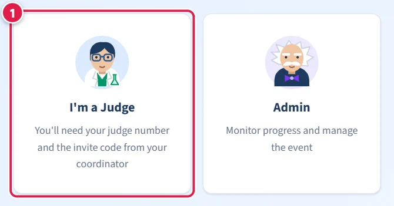
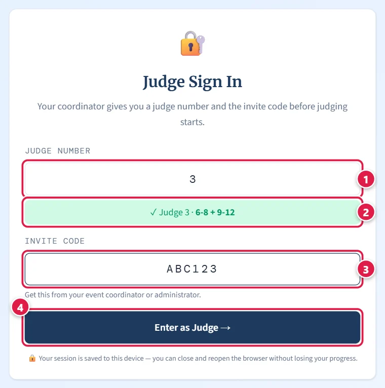
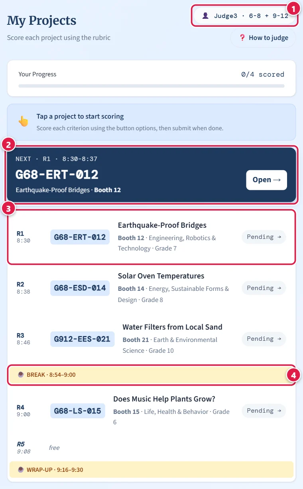
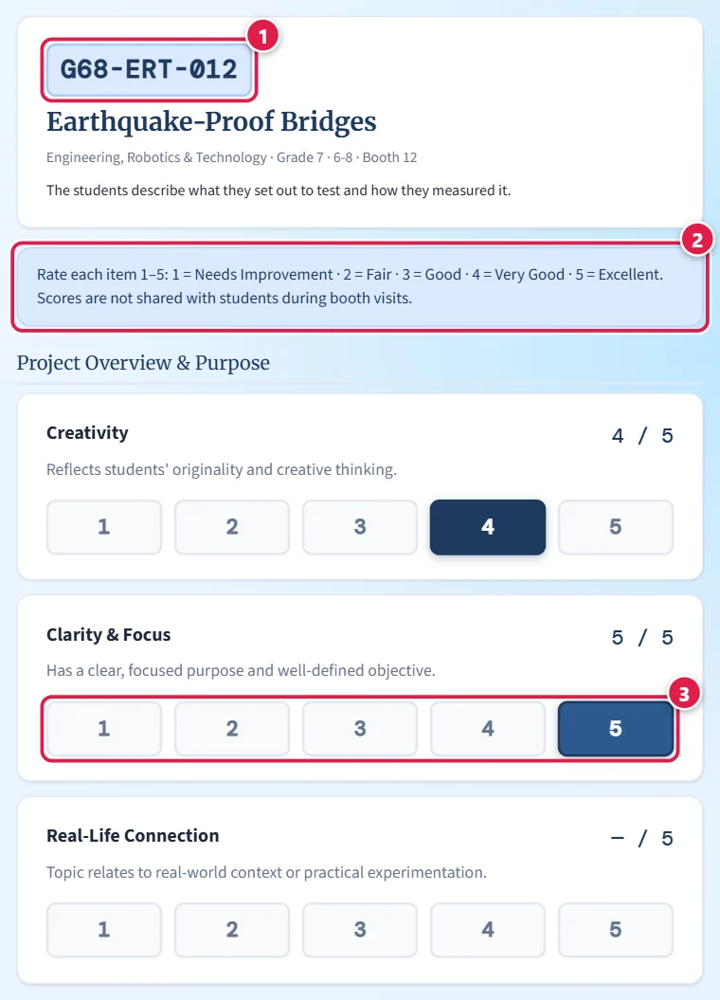
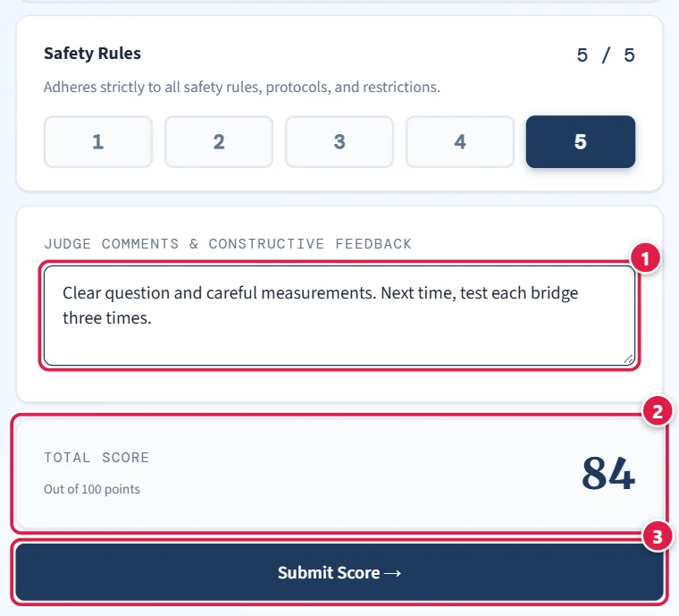
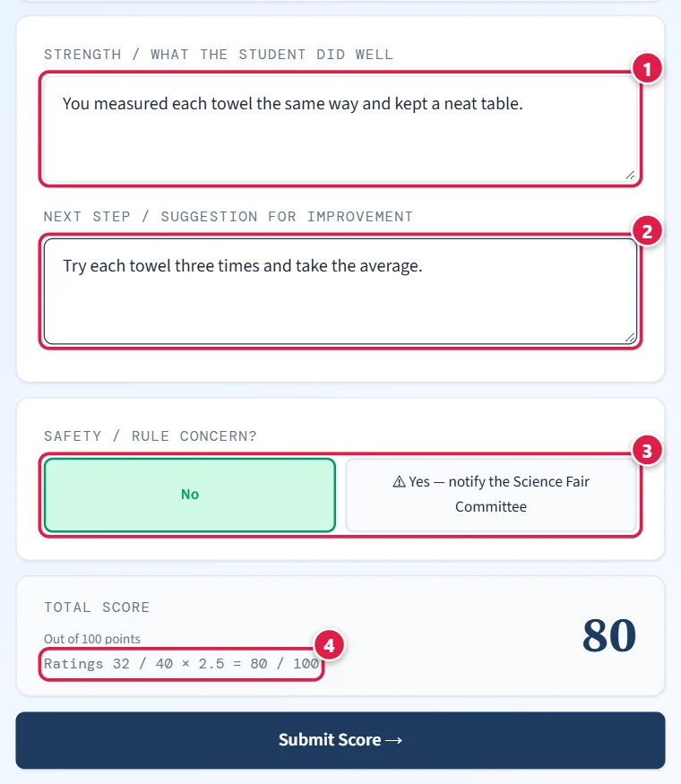
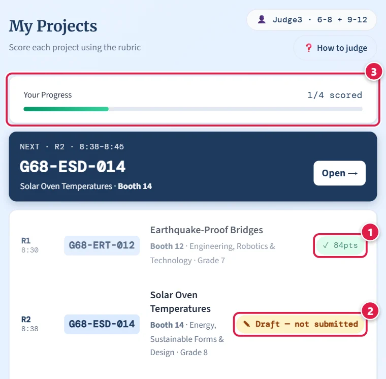
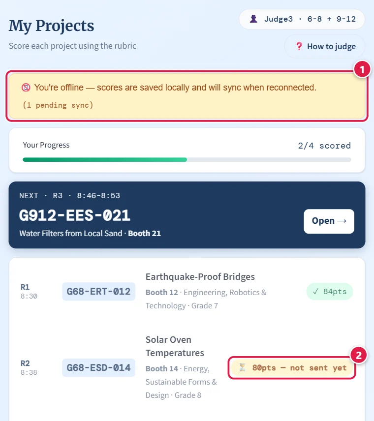
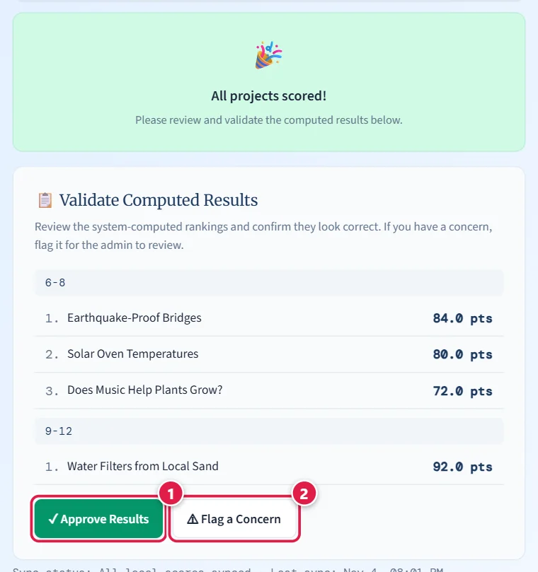

# Judge Instructions — Science Fair Judging App

Thank you for judging! This guide shows every step with pictures of the real screens. The red
numbers in each picture match the numbered lines under it.

> **On the tablet:** tap **❓ How to judge** — on the sign-in screen or above your project list — for
> the same steps with pictures. It works without internet.

---

## Before you start

**You'll need:**

- **Your school's link** — it looks like `https://qritiko.com/s/your-school`. Your coordinator gives
  you the exact address. A plain `qritiko.com` with no `/s/…` does **not** show your fair.
- Your **judge number** (for example **3**). Each number belongs to one person. You do **not** choose
  a department — the app fills it in from your number. One judge may cover **two or more
  departments**; the sign-in screen then shows them all (e.g. *"✓ Judge 3 · 6-8 + 9-12"*).
- The **invite code** (a short code from your coordinator).
- A tablet, phone or laptop. Internet helps, but you can keep scoring without it (see step 7).
- Time: at the 2026-27 fair each visit is **7 minutes**; your schedule lists your rounds.

---

## Quick start, with pictures

### 1. Open the fair

On the tablet, open the link your coordinator gave you.

1. Tap **I'm a Judge**.

💡 Use only that link — never another address. The tablet remembers your sign-in for that address only.

### 2. Sign in

1. Type your **judge number** — just the number, e.g. `3`.
2. Check the **green line**: your number and your department(s). If it looks wrong, ask the
   coordinator before you go on.
3. Type the **invite code**.
4. Tap **Enter as Judge →**. It says *Checking…* for a moment; extra taps are ignored.

💡 Sign in at the briefing, not when round 1 starts. **5 wrong codes lock this tablet for 5 minutes**
(*"Too many attempts. Try again in N seconds"*) — ask for the code instead of guessing; capitals do
not matter. You stay signed in, even if you close the browser.

### 3. Your judging schedule

1. **Who this tablet is signed in as** (e.g. *👤 Judge3 · 6-8 + 9-12*). If it is not you, tell the
   coordinator.
2. **NEXT** — the project to visit now: its code, title and booth. Tap **Open →** to score it.
3. **All your rounds in order**, with the start time, the project code and the booth.
4. **Breaks** (and any round with nothing for you, marked *free*).

💡 Find the booth by the **project code** on its sign. The times are the plan: NEXT moves on when you
submit a score, not by the clock. You may also get a printed sheet with the same rounds — tick each
project on it when you have submitted it in the app. Standing in for another judge? Sign in with
**their** number: you get their projects in their rounds.

*No schedule at your fair?* You simply see your list of projects (grouped by department if you cover
several) — tap one to start. In a big department you may get only a share of its projects; that is
normal.

### 4. Score the project

1. Check that this **code matches the booth sign**.
2. The **rating scale** for this form (e.g. 1 = Needs Improvement … 5 = Excellent).
3. Tap **one number for each item** — the chosen one turns dark blue. Tap another number to change it.

💡 Keep the screen to yourself: scores are not shared with students during the visit.

### 5. Add a comment and submit

1. **A comment** for the students — optional, but it helps them most.
2. The **total** adds itself up.
3. Tap **Submit Score →**. It stays grey until every item has a rating; the amber line under it says
   how many are left — tap it to jump to them.

💡 On weak Wi-Fi Submit waits at most about 15 seconds; then the score is kept on the tablet and sent
later, and you go back to your list as normal.

### 6. K-5 only: comments and the safety question

1. **Strength** — what the student did well.
2. **Next step** — one helpful suggestion.
3. **Safety / rule concern?** Leave **No**. Tap **Yes — notify the Science Fair Committee** only if
   something is unsafe or against the rules — the organiser sees it at once. Please tell a committee
   member too.
4. You rate 1–5; the app counts **× 2.5** like the paper form, so the total is out of 100
   (e.g. *Ratings 32 / 40 × 2.5 = 80 / 100*).

### 7. Back on your list

1. **✓ and the points** — scored and saved.
2. **✎ Draft — not submitted** — you started this one but did not submit. Your taps are kept on this
   tablet (even through a refresh or a restart) — open it to finish, or press **Discard draft** to
   start over. A draft does **not** count until you submit it.
3. **Your progress.**

💡 To change a score, tap the project again and submit again — until you validate your results or the
coordinator locks judging.

### 8. No internet? Keep scoring

1. The **yellow bar** means this tablet is offline. Keep going — your scores are kept on the tablet.
2. **⏳ … — not sent yet** — saved on this tablet and sent by itself when the connection is back
   (straight away, every 20 seconds while any are waiting, and when the tablet wakes up). It changes to
   **✓** once it reaches the server.

💡 Do **NOT** sign out, clear the browser, or score the project again. When you are back online press
**Sync Now** (bottom of your list) if anything is still waiting. You cannot sign out while scores are
only on the tablet — the app shows a warning instead of the Sign Out button.

### 9. When everything is scored: validate

1. **Approve Results** if the ranking of your projects looks right.
2. **Flag a Concern** if something looks wrong — write a short note, then tap **Submit Concern**.

💡 After you validate you can no longer change scores. Changed your mind? **Revise my validation** works
until the results are finalized.

---

## The 2026-27 forms

The app shows each department's own form. Trust what the screen shows over this page.

**Middle & High School form (6-8, 9-12)** — 20 items under five headings (Project Overview & Purpose ·
Scientific Inquiry & Method · Data & Conclusion · Presentation & Defense · Research, Collaboration &
Compliance). Tap **1 to 5** for each item, exactly like circling on the paper form:
1 = Needs Improvement · 2 = Fair · 3 = Good · 4 = Very Good · 5 = Excellent. Out of 100 (the lowest
possible total is 20). Then write your **Judge Comments & Constructive Feedback**.

**Elementary form (K-5)** — 8 items. Judge age-appropriately: focus on the student's own work,
thinking, evidence and understanding — not the cost or look of the project. 1 = just starting ·
3 = getting there · 5 = shining. Each number shows its points underneath because the form counts
× 2.5. Then Strength, Next step and the safety question (step 6 above).

**PreK & SPED Recognition form** — 4 criteria: **Curiosity · Hands-On Exploration · Sharing What They
Learned · Effort and Teamwork**, each 1–5 (whole numbers); under each one the form says what 5, 3–4
and 1–2 look like. Out of 20. Help from an adult or a communication device **never lowers a score** —
score the child's effort and participation, not the materials. Tips from the rubric sheet: about
1 minute hello, 4 minutes exploring and talking, 2 minutes celebrating and scoring; get down to eye
level, smile and give plenty of time to answer; enter scores right after the visit; never compare
projects — the totals set the places and every child gets a ribbon. A comment is optional.

**Tips for every form:** look at the whole project before you rate; use the scale the same way for
every project; rate each project on its own, never against the one before; a short, kind, specific
comment is worth more than a long one.

---

## Validation, concerns and deliberation

- When every project in your list is scored, a **📋 Validate Computed Results** section appears with your
  projects ranked within each department. Approve, or flag a concern (step 9).
- **A concern holds up the final results** until it is resolved. Once you and the coordinator have
  talked it through, press **Revise my validation** and approve (the coordinator can also clear it).
- If a project is **added to your list after you validated**, your screen says so: press **Revise my
  validation**, score it, and validate again.
- *"below N%"* next to a project means your school set a minimum score to place and that project is
  under it. It keeps its score and position — it just cannot take a medal. Not a fault; no need to flag
  it. (The 2026-27 fair does not use a minimum.)
- **💬 Deliberation Notes** — if the coordinator opens deliberation (usually to break a tie), a section
  appears under your list. For any project you can pick a recommendation (Recommend for Award · Strong
  Contender · Good Work · Needs Improvement), add a comment, tick **🚩 Flag this project for
  discussion**, and press **Submit Note** (later **Update Note**). It is optional unless the coordinator
  asks.
- If you see red **"Your validation was NOT saved"** or **"Your note … was NOT saved"**, nothing was
  recorded — check the Wi-Fi and press the button again.

---

## Messages you might see

| On screen | What it means | What to do |
|---|---|---|
| *Judge N is not on this school's judge list* | Wrong number | Check your number with the coordinator |
| *JudgeN is already signed in. Ask the admin to approve a device transfer.* | Your number is signed in on another tablet (or this one, earlier) | Ask the coordinator to press **Allow Transfer**, then sign in again within 10 minutes |
| *Invalid invite code* | Typo in the code | Type it again carefully; ask if unsure |
| *Too many attempts. Try again in N seconds.* | 5 wrong codes on this tablet | Wait, then type the code carefully. (30 wrong codes across the school lock every tablet for 5 minutes) |
| *🔒 Judging is currently locked by the administrator.* | Scoring time is over or paused | Projects cannot be opened until the coordinator unlocks judging |
| *Your score was NOT saved* | Neither the server nor the tablet could keep it | Stay on the screen — your answers are there. Check the Wi-Fi and press Submit again |
| *⏳ … — not sent yet* (in the list) | Saved on the tablet, waiting for a connection | Keep scoring; join the Wi-Fi; press **Sync Now** |
| *The server has not accepted one of them after several tries* | The server refuses a waiting score | Do **not** sign out or clear the browser — tell the coordinator |
| *Can't reach the server* | Offline, and this tablet never opened the fair before | Connect to Wi-Fi — it tries again by itself |
| *The scoring form could not be loaded* | That department's form could not be fetched | Check the Wi-Fi and press **Try again** (the app never shows a different form instead) |
| *This project is no longer on your list* | The coordinator moved or removed it | Go back to your list and carry on |
| *No projects are assigned to you yet* | Your number has no projects yet | Tell the coordinator your number — the list fills in by itself |
| *Something went wrong on this screen* | An unexpected error | Tap **Reload** — saved scores and unsent work stay on the tablet |

Some schools number judges separately in each department: if your sign-in screen shows a list of
departments, tap the one your coordinator named and type your judge name (e.g. `Judge1`). There, *"…
is full"* means all its places are taken — tell the coordinator.

---

## FAQs

**Which projects will I score?**
Only the ones on your list — usually your schedule's visits, every project in your department, or an
even share of it in a big department. Projects you already scored never disappear if the list changes.

**Can I change a score after submitting?**
Yes — open the project and submit again, until you validate or the coordinator locks judging.

**The tablet shows someone else's judge number.**
It is still signed in as an earlier judge. Tell the coordinator — do not score on it. They can sign it
out, or move your sign-in to it with Allow Transfer.

**My tablet died, or I have to use another tablet.**
Tell the coordinator. They press **Allow Transfer** for your number; within 10 minutes sign in on the
other tablet with the same number and invite code. Scores already sent are kept; scores that were only
on the old tablet are not — get it online first if you can.

**Can I leave and come back?**
Yes — the tablet stays signed in and keeps your drafts. Signing in again on another tablet needs the
coordinator's **Allow Transfer** first.

**I typed the wrong number.**
Tell the coordinator before you score anything — they can remove that sign-in so you can sign in again
with the right number.

**Who sees my scores and comments?**
The organisers. The public results never show judge names or student names.

**If something else goes wrong:** don't clear the browser. Tell the coordinator your judge number,
what you were doing, and the exact message (a photo of the screen helps).

---

## Other forms (only if your school uses them)

Your coordinator chooses each department's form; the 2026-27 fair uses the three above. If yours looks
different:

- **Buttons with words** (Needs improvement … Excellent) — the Cibecue / ISEF-style 100-point rubric:
  one rating per section; the points under each word differ by section. The lowest total is 20.
- **About 20 rows under five headings, rated 1–5** — the earlier detailed 20-item form (100 points).
- **Buttons 0–6** — the Northeast AZ 42-point rubric: 0 = not present · 1/2 = partial · 2/4 = complete ·
  3/6 = exceptional. Projects below grade 5 skip Abstract (out of 36); grade 5 and up cannot get a 0.
- **A purple "not scored" note and commendation buttons** — a comments-only group: pick a commendation
  (or type your own), add an optional comment, press **Submit Review**. Nothing is ranked.

---

## Summary

1. Open your school's link → **I'm a Judge** → your **number** and the **invite code**.
2. Follow **NEXT**: check the code at the booth, rate every item, comment, **Submit Score**.
3. No internet? Keep scoring — never sign out or clear the browser while scores wait.
4. When all are scored, **Approve** (or flag a concern).

**Thank you for being a fair, thoughtful judge!**
